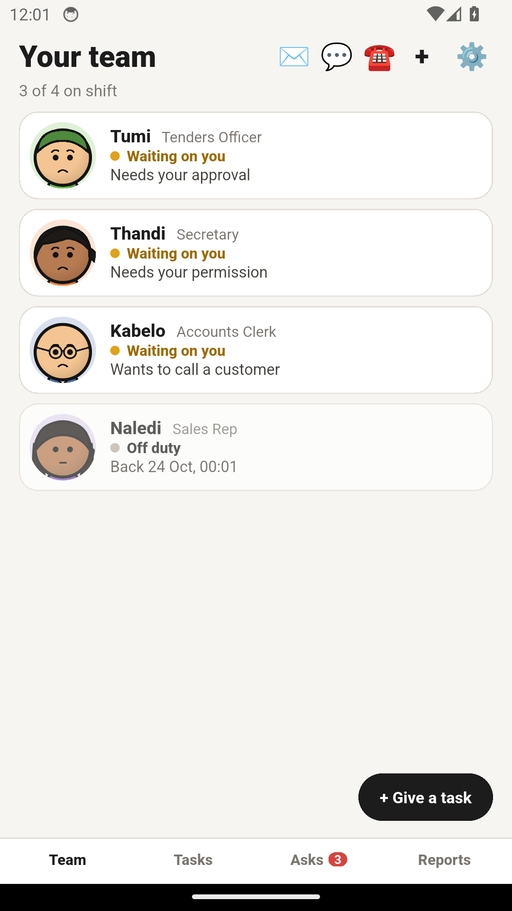
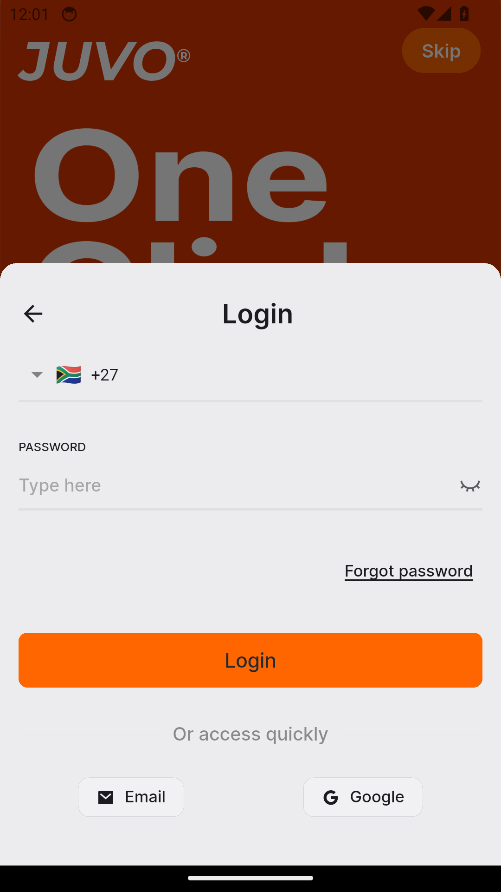
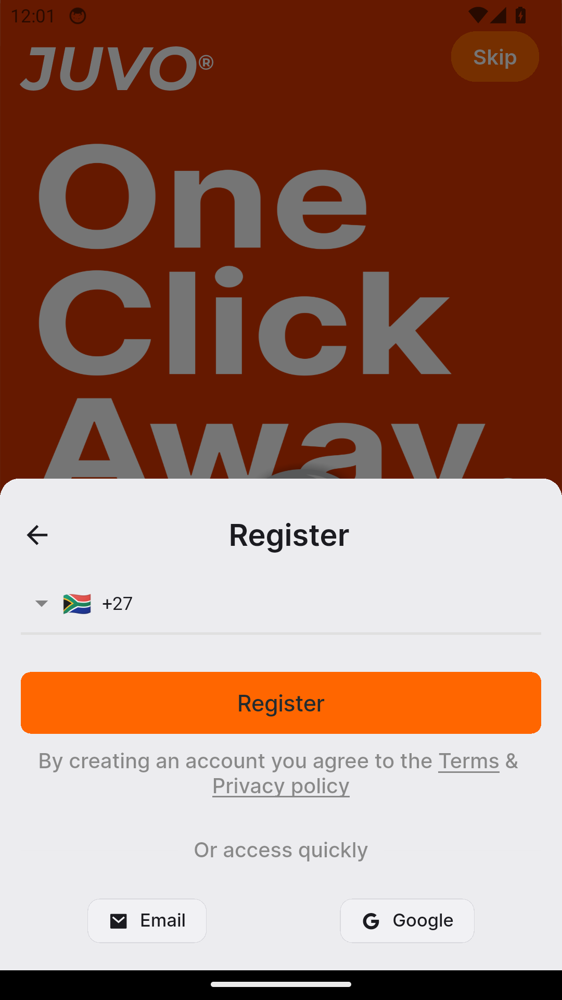
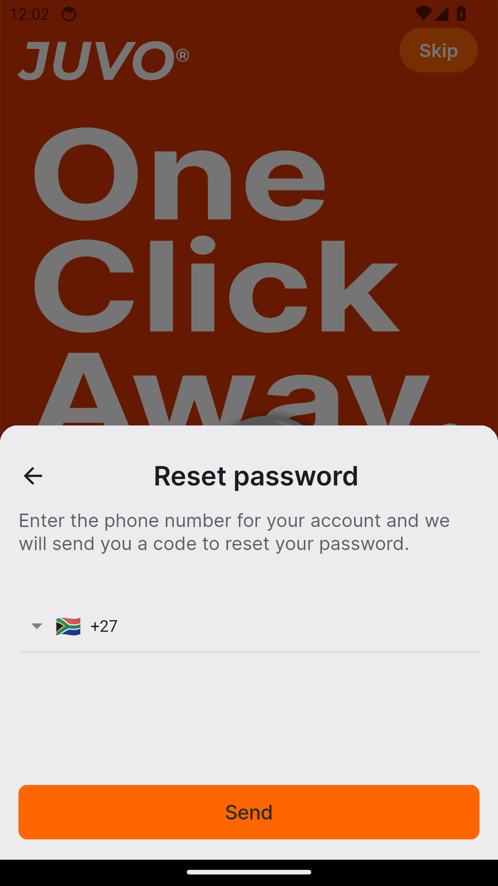
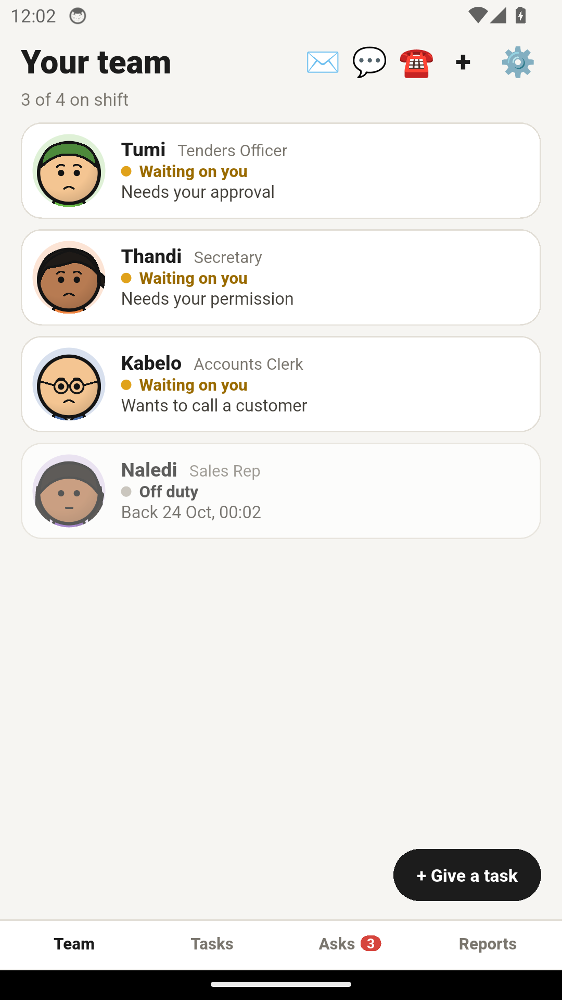
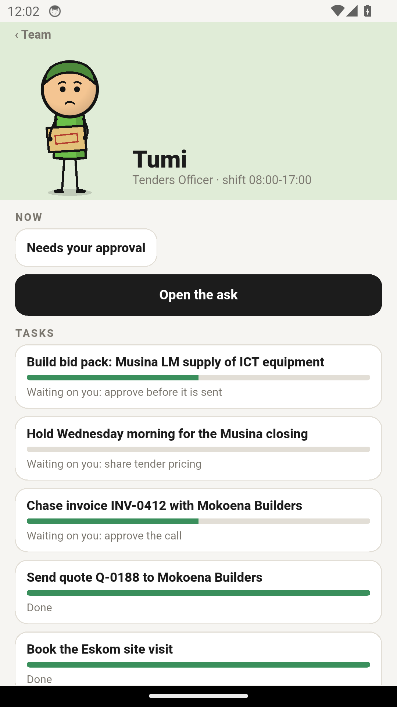
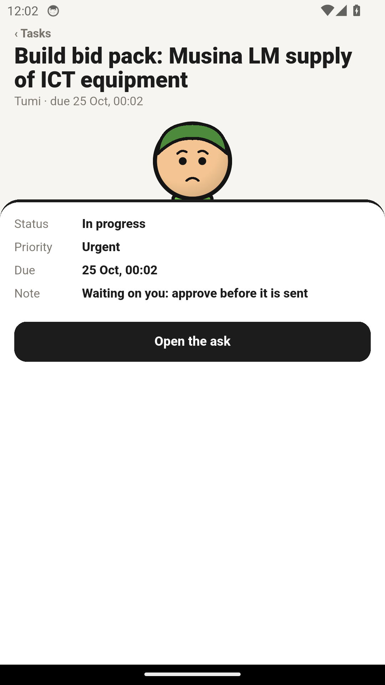

# Sticks — Feature Guide

AI employees that get the work done

> This guide is generated automatically on every merge: CI builds the
> app, walks the guided tour on an Android emulator, and captures
> each screen below.

## 1. Welcome to Sticks

Sticks gives you a team of AI employees - sign in to meet them.

## 2. Sign in

Signing in to Sticks is quick and simple.

## 3. Create an account

New to Sticks? Create your account in a few easy steps.

## 4. Reset your password

Forgot your password? Sticks gets you back in with a secure reset.

## 5. Your team

Each Stick is an AI employee with a job, a shift and a day's work.

## 6. One Stick

See what a Stick owns, what it is doing now, and what needs you.

## 7. Guided task run

Approve the work a Stick prepared before anything is sent.
